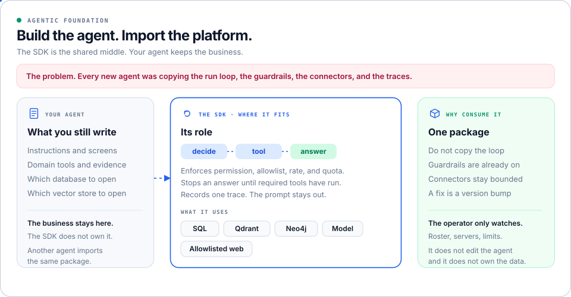

# Agentic Foundation



A shared Python SDK for business agents. Each new agent imports `agentic-foundation-sdk` instead of copying the run loop, the guardrails, the connectors, and the traces.

The agent still owns its instructions, screens, database, vector store, and domain tools. The SDK owns the mechanics those agents all need.

## The problem

Without this SDK, every agent rewrites the same platform: the decide / tool / answer loop, permission checks, allowlists, rate and token limits, SQL and retrieval calls, and a trace for each run. The copies drift. The next agent starts over.

## Where the SDK fits

Your agent imports the package. The SDK sits between that agent and the stores it is allowed to call. The operator console watches the run. It does not edit the agent and it does not own the data.

## What the SDK does

- Runs the loop: decide, call a tool, then answer.
- Requires named evidence tools before an answer.
- Enforces permissions, allowlists, request rate, body size, and daily and monthly token quotas.
- Retries a model call, can fall back to one other provider, and can extract structured JSON.
- Records a usage receipt: provider, model, tokens, latency, and cost. The prompt stays out.
- Writes one trace per run: status, duration, and tool names. The question and the answer stay out.
- Issues scoped credentials beside the static bearer, and those credentials can be revoked.
- Runs registered jobs on the leader, inline when no queue is configured.
- Reports degraded dependencies and a content-free audit event.
- Checks a workflow for required tools and JSON fields. It does not grade whether the answer is true.

## What it connects to

The agent opens the connection and chooses the database. The SDK checks the permission, the allowlist, and the cap.

| Port | Used for |
|---|---|
| Read-only SQL | An allowlisted table |
| Qdrant | Vector retrieval for one tenant and agent |
| Neo4j | One-hop graph context |
| Model | A registered prediction |
| Allowlisted web | One approved host |

## Why import it

The next agent does not copy the loop. Guardrails and connectors are already bounded. A platform fix is a version bump, not a rewrite of every agent.

## Start here

- [How to use the SDK](docs/how-to-use.md)
- [Reading order](00-START-HERE.md)
- [Developer guide](docs/developer-guide.md)
- [Folder index](docs/folder-index.md)

```sh
python -m pip install -e '.[runtime,service,dev]'
python -m unittest discover -s tests -v
```

Commits on this repository are made as [SANDESHSALUNKE143](https://github.com/SANDESHSALUNKE143). Push with a personal access token for that account, stored locally. Do not commit the token.

MIT licensed. See [contributing](CONTRIBUTING.md) and the [security policy](SECURITY.md).
