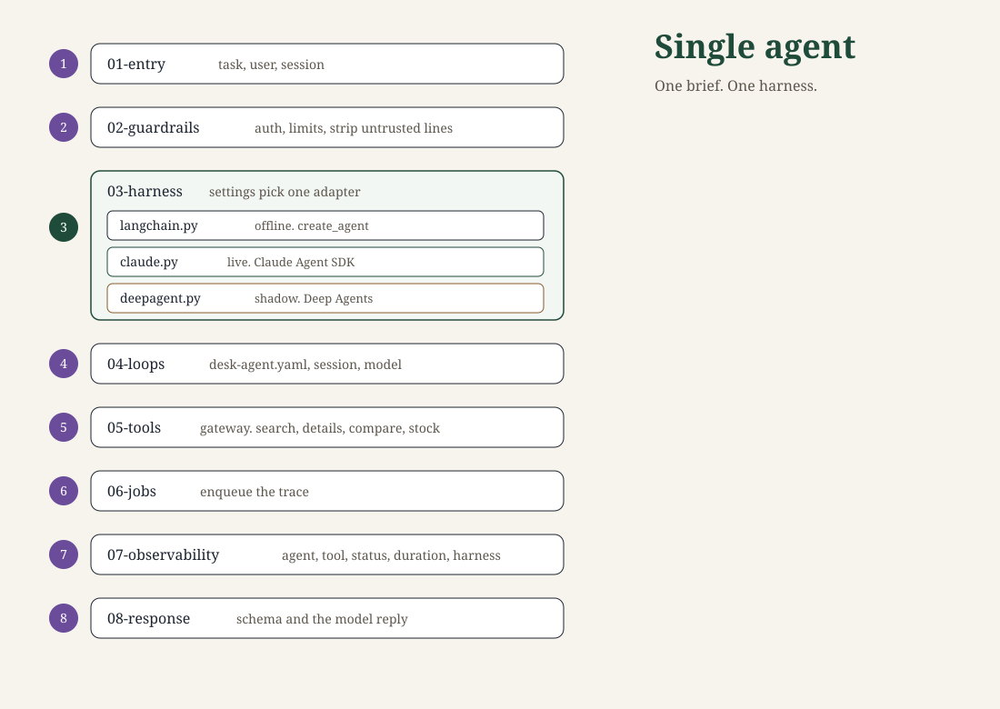

# Agentic architecture

Two architectures live in this repository. They do not import each other. Each folder has its own virtualenv, because the stage names (`entry`, `loops`, and the rest) bind once per process.

| Folder | What a brief becomes | Start |
| --- | --- | --- |
| [multi-agent](multi-agent/README.md) | An ordered run of specialists. LangGraph is the sequencer. | `cd multi-agent && ./start-local.sh` |
| [single-agent](single-agent/README.md) | One agent, `desk-agent`. One harness adapter runs. | `cd single-agent && ./start-local.sh` |

The local token in both folders is `local-dev-token-not-for-production`. `PLATFORM_ENV=production` refuses that token until `PLATFORM_DEV_TOKEN` is private.

## Multi-agent

LangChain runs each specialist from `agent.yaml`. LangGraph in `multi-agent/agentic/03-workflows/engine` walks the agent list and pauses for approval. With no API key, a mock model drives the same loop. n8n is a simulated write tool. It is not the sequencer.


From `multi-agent/`:

```bash
./start-local.sh
```

The API is <http://127.0.0.1:8090>. The merchant stand-in is <http://127.0.0.1:8091/mcp>. The console is <http://127.0.0.1:5173>. Health is `/health`. The platform map is `/platform`. Interactive API docs are `/docs`.

On one server, from `multi-agent/`:

```bash
docker compose up -d --build
./infrastructure/smoke.sh
```

The proof task is `Find a blue trail jacket under $150`. That selects `product-discovery`: shopping, then catalog, then inventory.

A request moves like this:

1. The console sends the brief.
2. `agentic/01-entry` checks the body size, the rate limit, and the bearer token.
3. `agentic/02-guardrails` checks the task size and strips instruction-like lines.
4. `agentic/03-workflows/router` uses an agents list, then a workflow name, then a phrase. A workflow file is only an `AGENTS` list.
5. An unknown agent, a hop past the limit, or a refused handoff ends the run before a tool is called.
6. LangGraph steps one agent at a time. Cancel is checked before each step. A timeout or a failure ends the graph.
7. The loop loads that agent's contract. Retrieval runs only when `rag.retrieve` is set. A note is stored only when `rag.capture` is set.
8. LangChain `create_agent` chooses the tool. Mock mode needs no key. Live mode is `ChatOpenAI` with `MODEL_API_KEY`. LangGraph is not inside this loop.
9. `agentic/05-tools/mcp/tool-gateway` checks the allowlist, the permission, the connection, and a repeated-call stop. A successful read can be reused for 30 seconds. A write is not cached.
10. A write in `approval.required_for` pauses. A different actor approves and the remaining agents run, or a rejection ends the run.
11. The result is projected onto `output_schema`. A missing field fails that agent.
12. The worker in `agentic/06-jobs/workers` stores the stage, the score, and the duration. The question is omitted. Learning does not change model weights.

A failed step does not replan. The next agent receives the same task.

| Workflow | Agents, in order | Selected when the task contains |
| --- | --- | --- |
| `product-discovery` | shopping, catalog, inventory | jacket, boot, lamp, stock, shop, product |
| `customer-support` | support, billing | refund, return, order status, order 1001, order 1002 |
| `order-processing` | order, billing | place an order, prepare an order, checkout, `buy ` |

`billing`, `research`, and `data-analysis` can also run alone. The contract for a specialist is `multi-agent/agentic/04-loops/specialists/<name>/agent.yaml`. The longer pages are [multi-agent/docs/architecture.md](multi-agent/docs/architecture.md), [multi-agent/docs/workflows.md](multi-agent/docs/workflows.md), and [multi-agent/docs/using.md](multi-agent/docs/using.md).

```bash
cd multi-agent
python -m unittest tests.unit.test_runtime tests.integration.test_api tests.security.test_security
python tests/agent-evaluation/run.py
```

## Single agent

`desk-agent` finishes the same jacket brief by itself. There is no router and no LangGraph sequencer. The numbered folders are the request order. `03-harness` is the loop. The console settings panel writes `harness` on `single-agent/agentic/04-loops/specialists/desk-agent/agent.yaml` through `PUT /settings/harness`.



From `single-agent/`:

```bash
./start-local.sh
```

The API is <http://127.0.0.1:8092>. The merchant stand-in is <http://127.0.0.1:8093/mcp>. The console is <http://127.0.0.1:5174>.

The harness slot has three adapters. Only one runs:

| `harness` | Adapter | When it runs |
| --- | --- | --- |
| `langchain` | LangChain `create_agent` | Shipped default. No key uses the mock. Live mode uses `ChatOpenAI` when `MODEL_API_KEY` is set. |
| `claude` | Claude Agent SDK `query()` | Provisional live harness. Needs `ANTHROPIC_API_KEY`. Without the key the run fails. It does not fall back to the mock. |
| `deepagent` | Deep Agents `create_deep_agent` | Shadow run of the same task. Needs a live model key. Filesystem, shell, and subagent tools stay off. |

A request moves like this:

1. `agentic/01-entry` turns the body into a task, a user, and a session.
2. `agentic/02-guardrails` checks the token, the rate limit, the task size, and strips instruction-like lines.
3. `agentic/03-harness/runtime.py` loads the contract and calls the selected adapter. Earlier turns in the session go into that call.
4. `agentic/04-loops` holds `desk-agent/agent.yaml`, the session, and the model choice.
5. `agentic/05-tools/mcp/tool-gateway` calls `search_products`, `get_product_details`, `compare_products`, and `check_stock`. A tool that is not on the contract is denied.
6. `agentic/06-jobs` enqueues the trace. The question is not stored.
7. `agentic/07-observability` stores the agent, the tool, the status, the duration, and the harness name.
8. `agentic/08-response` projects the tool results onto `output_schema` and keeps the model reply. A missing field fails the run.

The proof task is the same sentence: `Find a blue trail jacket under $150`. The longer pages are [single-agent/docs/architecture.md](single-agent/docs/architecture.md), [single-agent/docs/using.md](single-agent/docs/using.md), and [single-agent/docs/api.md](single-agent/docs/api.md).

```bash
cd single-agent
python -m unittest tests.unit.test_harness tests.integration.test_api tests.security.test_security
```
