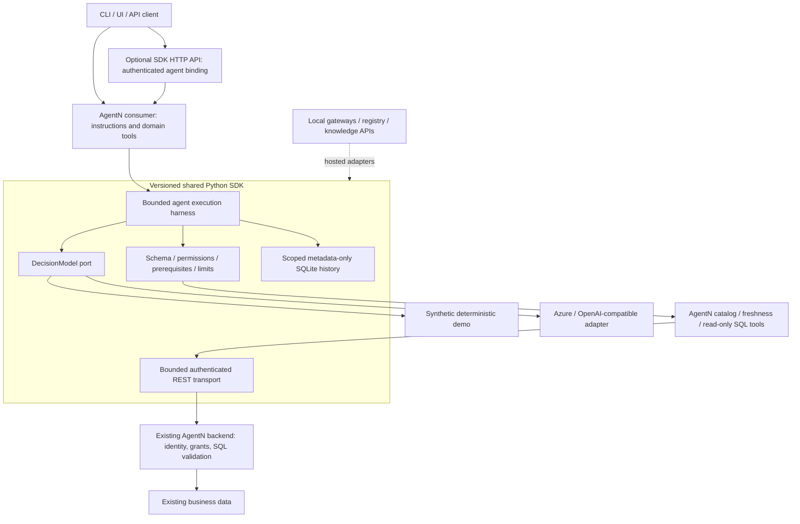

> **Source layout updated:** The architecture folders now contain the real Python implementation. See [the source map](docs/source-layout.md). `src/agentic_sdk` retains compatibility entrypoints.

# Agentic Foundation


A reusable, framework-agnostic Python platform for building business agents without copying the execution loop, provider integration, transport, policy checks or telemetry storage into every project. The versioned `agentic-foundation-sdk==0.3.0` is the reusable product. Each agent owns its instructions, screens, database, vector store, domain tools, configuration and evaluations. Start with [how to use the SDK](docs/how-to-use.md).

Commits on this repository are made as [SANDESHSALUNKE143](https://github.com/SANDESHSALUNKE143). Push with a GitHub personal access token for that account, kept in your local credential store. Do not put the token in this file, in a commit, or in an image.

**SDK 0.3.0 full local platform:** [Run the full stack](deployment/full/README.md) and follow the [agent developer guide](docs/developer-guide.md).

**Earlier minimal path:** [Build and test AgentN in Docker](deployment/local/README.md). **Explore the code:** [Numbered architecture guide](00-START-HERE.md). **Build another agent:** [Developer standard](developer-standards/agent-developer/SKILL.md).

## Overall architecture



The SDK owns reusable mechanics; the consumer owns business meaning; the backend owns data authorization. A central service is optional: agents can import the SDK directly or expose it through the shared HTTP implementation. The local image packages both distributions while preserving this ownership boundary.

## Run the full platform on local Docker

```powershell
./scripts/full-platform.ps1 start -AgentNSource 'D:/Projects/AgentN/agent-n-assistant'
```

AgentN uses the hosted model/tool paths. PostgreSQL, Qdrant, ingestion worker, Collector, Prometheus, Loki, Tempo and Grafana run alongside it. Credentials persist in an ignored local file. Read the [runbook](deployment/full/README.md) for API access, live providers, stopping and Linux deployment.

## Minimal AgentN-only Docker alternative

Prerequisites: Docker Desktop running Linux containers and Compose 2.17+. From this repository:

```powershell
./scripts/local-agentn.ps1 -Action start -AgentNSource 'D:/Projects/AgentN/agent-n-assistant'
```

This builds the current SDK into a wheel, installs it into the separate AgentN consumer image, and runs an authenticated API on loopback port 8010. It verifies catalog -> freshness -> answer, anonymous access rejection, and history persistence after restart. The token is generated in your shell and is not printed. The default uses synthetic data and deterministic readiness logic; it does not interpret arbitrary questions or query the existing application. See the [local runbook](deployment/local/README.md) for testing, stopping, Linux commands and connecting an approved live backend/model.

## Repository ownership and reading order

| Sequence | Section | Responsibility |
|---|---|---|
| 01 | [contracts](contracts/README.md) | Provider-neutral types and compatibility |
| 02 | [core](core/README.md) | Harness, context, execution and policies |
| 03 | [adapters](adapters/README.md) | Providers, retrieval, persistence and observability |
| 04 | [services](services/README.md) | Optional service boundaries and planned components |
| 05 | [sdk/python](sdk/python/README.md) | Versioned package consumption |
| 06 | [tests](tests/README.md) | Behavioral, contract and compatibility evidence |
| 07 | [deployment](deployment/README.md) | Local Docker first, then Ubuntu and future Helm |
| 08 | [developer-standards](developer-standards/README.md) | Canonical skill, templates and validators |
| 09 | [examples](examples/README.md) | Minimal RAG and independent consumer paths |

Executable Python lives directly in `core/`, `contracts/`, `adapters/`, `services/`, and `sdk/python/`. Setuptools packages these folders under `agentic_sdk`; `src/agentic_sdk` preserves older public imports through thin re-exports. `config` and `schemas` define configuration; `deploy` holds optional infrastructure assets; `docs` holds ADRs, security and operating guidance. The independent consumer owns `src/agentn_assistant`; it imports the SDK. The root Dockerfile/Compose retain the smaller RAG example and optional data/collector profiles; the AgentN path uses `deployment/local/compose.yaml`.

## Implemented versus planned

| Capability | Status |
|---|---|
| Typed contracts, registry, bounded model/tool loop, schema and scope checks | Implemented and tested |
| Azure/OpenAI-compatible models, embedding/index compatibility, Qdrant and OTel adapters | Implemented; cloud behavior not live-validated |
| Authenticated agent API, concurrency cap, remote client, scoped SQLite metadata | Implemented prototype; static token bindings |
| Independent AgentN consumer, synthetic workflow and REST backend adapter | Implemented; local Docker acceptance path |
| Local model/tool APIs, revisioned registry, ingestion worker | Implemented in hosted.py; custom visual portal remains planned |
| Native Anthropic, MCP session and n8n webhook adapters | Implemented with contract tests; live integration and MCP transport lifecycle require consumer configuration |
| Durable PostgreSQL token reservation ledger | Implemented; OIDC, currency budgets and conversation checkpoints remain planned |
| Grafana/Prometheus/Loki/Tempo Docker stack | Implemented under deployment/full; production Helm remains planned |

Per-agent SDK scope checks do not replace backend authorization. Metadata storage is content-free; production telemetry access isolation and monetary enforcement need additional infrastructure. See [security](docs/security.md), [implementation map](docs/implementation-map.md), [resource/cost controls](docs/nfr-cost.md), and [architecture](docs/reusable-architecture.md).

## Development and validation

```sh
python -m pip install -e '.[runtime,service,dev]'
python -m unittest discover -s tests -v
python scripts/validate_config.py
```

Optional provider/telemetry tests require `.[providers,telemetry]`. AgentN has its own domain tests and pinned SDK dependency. [Verification](docs/verification.md) distinguishes mocked tests from live checks. Publish SDK releases to an approved package registry; public PyPI availability is not assumed. Before release, lock dependencies, scan images and evaluate real domain questions.

MIT licensed. Keep production credentials, internal endpoints and customer data out of source and images. See [contributing](CONTRIBUTING.md) and [security policy](SECURITY.md).


## Folder contents

Project entrypoint, package metadata, license and default local RAG profile.

- [.github/](.github/README.md): Repository review and automation metadata.
- [adapters/](adapters/README.md): External-system implementations and compatibility exports.
- [config/](config/README.md): Public demo and placeholder configuration; no real endpoints/keys.
- [contracts/](contracts/README.md): Provider-neutral data types and compatibility exports.
- [core/](core/README.md): Reusable framework-neutral behavior.
- [deploy/](deploy/README.md): Earlier reference infrastructure; not the supported full profile.
- [deployment/](deployment/README.md): Supported local profiles and operating runbooks.
- [developer-standards/](developer-standards/README.md): Canonical engineering skill and supporting assets.
- [docs/](docs/README.md): Current implementation guides, references and historical baseline.
- [evaluation/](evaluation/README.md): Offline RAG smoke evaluation; separate from real answer-quality certification.
- [examples/](examples/README.md): Executable minimal RAG example.
- [schemas/](schemas/README.md): v1 RAG and v2 project JSON schemas.
- [scripts/](scripts/README.md): Validation, full-stack acceptance and local lifecycle helpers.
- [sdk/](sdk/README.md): Python consumer-facing configuration/CLI/client package.
- [services/](services/README.md): Local API composition and shared bounded input models.
- [src/](src/README.md): Stable legacy source/import namespace.
- [templates/](templates/README.md): Illustrative adapter contribution template.
- [tests/](tests/README.md): Discoverable SDK unittest modules.

## Complete folder inventory

See the [reviewed folder index](docs/folder-index.md) for every maintained directory and its responsibility. Run `python scripts/check_repository.py` to check folder guides, public API docstrings, local links and package mappings.
