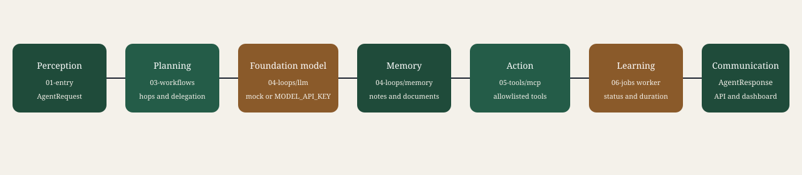

# Agentic architecture

Reference implementation for an industry team building the agentic platform it has announced. The retail agents are the worked example. The contract, the gateway, and the approval rule are the standard you keep.

LangChain runs each specialist from `agent.yaml`. LangGraph sequences the three workflows and pauses for approval. With no API key, a mock model drives the same loop.



Read [docs/implementation-guide.md](docs/implementation-guide.md) before changing code. The same page is the first item under Docs in the console.

## Start the reference

`python` is not required on your shell path. This repository keeps its interpreter in `.venv`.

```bash
./start-local.sh
```

The script starts the API at <http://127.0.0.1:8090> and the console at <http://127.0.0.1:5173>. The local token is `local-dev-token-not-for-production`. Health is `/health`. Interactive API docs are `/docs`.

Prove the path with this task:

```text
Find a blue trail jacket under $150
```

Read the live trace. Then open `agents/catalog-agent/agent.yaml`. That file is the contract: instructions, plugins, memory, permissions, and `output_schema`.

## Seven components

These stay in place when you replace the retail fixtures with your systems.

1. **Perception** — `apps/agent-api` turns the HTTP body into an `AgentRequest`.
2. **Planning** — `orchestrator/planner` orders the agents and checks hops and delegation. It does not write the answer.
3. **Foundation model** — `shared/llm` chooses the next step. Mock mode needs no key. Live mode uses `MODEL_API_KEY`.
4. **Memory** — `shared/memory` holds conversation state, optional notes, and RAG. An agent reads the index only when its contract sets `rag.retrieve`. Capture stores a redacted note only when `rag.capture` is true. Vector and embedding choices include a local index, Qdrant, and AWS.
5. **Action** — `mcp/tool-gateway` calls only the plugins named in `agent.yaml`.
6. **Learning** — `shared/evaluation` and traces record status, tool names, and duration. They do not store the raw question or change model weights.
7. **Communication** — the `AgentResponse` is what the API returns and what the console shows.

## Standard you do not relax

1. The contract is written before the reasoning loop. LangChain does not own `agent.yaml`.
2. One runtime serves every agent. Authentication, logging, errors, and state are not copied per agent.
3. The gateway is the only caller. A plugin runs only when the contract lists it and the permission is true.
4. Every write stays in `approval.required_for`. The console cannot clear that. The order threshold is `amount_gte` on the order contract, default 100.
5. The console cannot grant `order_write` to a read-only agent, add a tool URL, or show a secret.
6. A result that misses `output_schema` is rejected.
7. Optional long-term memory may be read. It must not be invented. Citations must be known sources.
8. Instruction-like text in a task or a document is stripped.
9. An operator cannot approve a request raised by their own agent.
10. `PLATFORM_ENV=production` refuses the sample token.
11. Tests cover route, plugin, schema, denial, injection, and approval. Ruff is the Python check. Line length is 100.

The full placement rules are in [docs/implementation-guide.md](docs/implementation-guide.md).

## Folder structure

A request starts in `apps`, is planned in `orchestrator`, runs a contract from `agents`, and may call a plugin from `mcp`. Shared behavior lives in `shared`.

```text
agentic-architecture/
├── apps/                  What people open
│   ├── agent-api/         HTTP API on port 8090
│   └── admin-dashboard/   Console on port 5173
├── orchestrator/          Who runs, and in what order
│   ├── router/            Picks a workflow or the agents you selected
│   ├── planner/           Checks hops and whether a handoff is allowed
│   ├── workflow-engine/   Runs the agents and pauses for approval
│   └── state-manager/     Stores the run and the approval decision
├── agents/                One folder and one agent.yaml per specialist
│   └── runtime.py         Loads the YAML and runs the LangChain loop
├── mcp/                   Plugins. The gateway is the only caller
│   ├── tool-gateway/      Allowlist, permission, and approval checks
│   ├── catalog-tools/     Search, details, compare, and stock
│   ├── order-tools/       Order status and a simulated order
│   ├── billing-tools/     The local discount rule
│   └── support-tools/     A refund request that waits for approval
├── shared/                Used by every agent
│   ├── llm/               Mock model, or a live model when MODEL_API_KEY is set
│   ├── memory/            Conversation notes and the document index
│   ├── security/          Permissions, delegation, and redaction
│   ├── evaluation/        Status, tool names, and duration
│   ├── contracts/         AgentRequest and AgentResponse
│   └── observability/     The trace
├── workflows/             Discovery, support, and order sequences
├── tests/                 Unit, API, security, and evaluation cases
└── docs/                  The guide an implementer follows
```

### apps

`apps/agent-api` receives the task and returns the response. `apps/admin-dashboard` is the operations console: Run, Agents, Plugins, Approvals, Settings, and Docs.

### orchestrator

The router chooses the agents. The planner stops a plan that is too long or that hands work to an agent that is not allowed. The workflow engine runs that plan and pauses when a write needs approval. The state manager keeps the run so a different actor can approve or reject it.

### agents

Each specialist is a folder such as `agents/catalog-agent/` with one `agent.yaml`. That file names the instructions, the plugins, the permissions, and the output shape. `agents/runtime.py` runs the same loop for every agent.

### mcp

`mcp/tool-gateway` is the only code that calls a plugin. It refuses a plugin that is not on the contract or that the permission does not allow. Catalog, orders, billing, and support are the reference packages. Stock, documents, and the sales file are registered from `shared/`.

### shared

The model, memory, security checks, evaluation record, and trace stay here. A new agent does not copy them.

### workflows, tests, and docs

`workflows` names product discovery, customer support, and order processing. `tests` checks routes, plugins, schema, denied calls, injection text, and approval. `docs` is the written standard.

## How a run moves

1. The console sends the task, and optionally a workflow or a list of agents.
2. The router picks who runs. A selected agent overrides the automatic route.
3. The planner refuses a hop the delegation rules do not allow.
4. Each agent loads its YAML contract and may call only the plugins connected to it.
5. A write plugin pauses until another actor approves it.
6. The response and the trace come back to the console. The trace does not store the raw question.

## Add your agent

1. Copy `agents/catalog-agent/agent.yaml` to `agents/<name>/agent.yaml`.
2. Register any new plugin in `mcp/tool-gateway/gateway.py` before the contract names it.
3. Set permissions the gateway already understands, and an `output_schema`.
4. Add one case in `tests/agent-evaluation/cases.json` that lists `expect_tools`.
5. Restart the API.

Settings configures one agent in tabs: the contract, RAG, observability, connectors, and MCP plugins. Connectors store a URL, connection string, username, and password, and a saved password is not shown again. Settings cannot grant `order_write` to a read-only agent or clear approval on a write.

## Observability

The API process records the agent, the tool name, the status, and the duration when the contract lists `platform_trace`. `evaluation` records the score. OpenTelemetry and a log store are optional tools on the same contract, configured with `OTEL_EXPORTER_OTLP_ENDPOINT` and `OBSERVABILITY_LOG_URL`. This reference keeps the record in the process. Field names and the feedback call are in [docs/operations.md](docs/operations.md).

## Tools you attach over years

The contract keeps the plugin name. The environment points at the host. Leave a port on its local stand-in until that host exists.

| Port | Variables | What this reference does |
| --- | --- | --- |
| Model | `PLATFORM_LLM_MODE=live`, `MODEL_API_KEY`, `MODEL_BASE_URL`, `MODEL_NAME` | Calls an OpenAI-compatible chat endpoint |
| SQL | `SQL_CONNECTION` | Marks the port configured. `query_sql` still returns the local `SELECT` fixture |
| Web | `WEB_ALLOWLIST` | Denies a host that is not listed. The page body stays local |
| n8n | `N8N_BASE_URL`, `N8N_TOKEN` | Does not call n8n. The write stays simulated and still needs approval |
| Vector search | `QDRANT_URL` | Marks Qdrant configured. Empty uses the local document index |
| Graph | `NEO4J_URL` | Marks Neo4j configured. It does not open a Neo4j session. Memory retrieval still uses the local entity graph |

The console shows whether each variable is set. It does not show the value. SQL, web, and n8n stay unavailable until a contract already has `sql_read`, `web_read`, or `n8n_write`.

## Where it runs

`./start-local.sh` starts both processes on the laptop. The API is `127.0.0.1:8090`. The console is `127.0.0.1:5173` and is the only page a browser opens.

`docker compose up -d --build` is the organization server. It builds `agentic-api` and `agentic-console` on that one machine. Operators open port 5173. The API is not published on the host. `GET /platform` names the seven steps, security, observability, and the files a business team edits. Prove it with `./deploy/smoke.sh`. The placement rules are in [docs/server.md](docs/server.md).

An industry host keeps those two processes. One API process stays on a private address, because approvals, traces, and notes live in that process. Operators open the console, and the console proxies to that API. The model, SQL, n8n, Qdrant, and Neo4j are other hosts you already run. Set one variable when that host is ready. Secrets stay in the API environment. `PLATFORM_ENV=production` refuses the sample token. The placement rules are in [docs/operations.md](docs/operations.md).

## Tests

```bash
.venv/bin/python -m unittest tests.unit.test_runtime tests.integration.test_api tests.security.test_security
.venv/bin/python tests/agent-evaluation/run.py
.venv/bin/python -m ruff check shared agents orchestrator apps mcp tests
docker compose up -d --build && ./deploy/smoke.sh
```

## Guide

| Page | Use it when you need |
| --- | --- |
| [Implementation guide](docs/implementation-guide.md) | The standard, where a change goes, and the build sequence |
| [One server](docs/server.md) | The two images, the seven steps, and the files a business team edits |
| [Operations](docs/operations.md) | The trace, n8n and the other ports, and where the two processes run |
| [Repository](docs/repository.md) | The folder map in more detail |
| [Architecture](docs/architecture.md) | The seven components and the folders that own them |
| [Workflows](docs/workflows.md) | When a sequence is required, how to add one, and where n8n fits |
| [Agent catalog](docs/agent-catalog.md) | The reference specialists and how to copy one |
| [Tool contracts](docs/tool-contracts.md) | Each plugin, its permission, and whether it needs approval |
