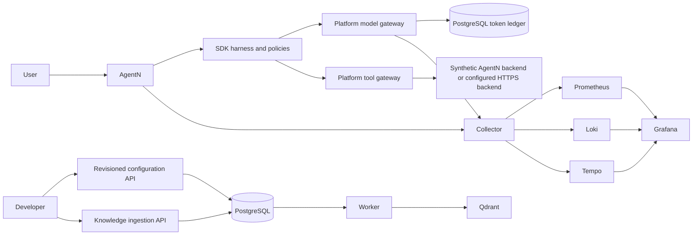

# Full local platform

Run from the platform checkout on Windows with Docker Desktop Linux containers:

```powershell
./scripts/full-platform.ps1 start -AgentNSource 'D:/Projects/AgentN/agent-n-assistant'
./scripts/full-platform.ps1 test
./scripts/full-platform.ps1 status
./scripts/full-platform.ps1 stop
```

First startup downloads images and builds the SDK and consumer. Stop any earlier AgentN demo bound to 8010 first. Only the two API ports and Grafana are published, on loopback. Credentials are generated once in ignored `deployment/full/.env`; do not share/commit it. The script reuses that file. Keep it backed up privately: changing POSTGRES_PASSWORD in the file does not rotate an initialized database password. Stop preserves every named volume.

| Component | Local entrypoint | State |
|---|---|---|
| AgentN API | http://127.0.0.1:8010/docs | Scoped SQLite metadata |
| Platform APIs | http://127.0.0.1:8020/docs | PostgreSQL registry, jobs, usage |
| Grafana operator dashboard | http://127.0.0.1:3002/d/agentic-overview | Grafana volume |
| Ingestion worker | Internal only | PostgreSQL queue; Qdrant collections |
| PostgreSQL / Qdrant | Internal only | Separate named volumes |
| Collector / Prometheus / Loki / Tempo | Internal only | Metrics/log/trace volumes |

Grafana login is `admin`, with GRAFANA_PASSWORD from the ignored file. Platform API calls use PLATFORM_AGENT_TOKEN; AgentN calls use AGENT_API_TOKEN. PLATFORM_OTHER_TOKEN is a deliberately restricted test identity. The API explorer is the configuration/API interface; a custom visual editing portal is not implemented.

## Request and data flow



Gateways, knowledge API and registry are separate logical modules/endpoints hosted in one platform process for this machine. The ingestion worker is a separate process. They are not four independently scaled microservices.

## Acceptance checks

The test publishes an immutable configuration revision, verifies stale-write conflict and scope denial, submits an idempotent synthetic ingestion job, waits for its worker, queries Qdrant, rejects another agent's access, invokes AgentN through both hosted gateways, and checks the persistent token ledger. Repeated tests create synthetic documents and revisions. This is an acceptance environment, not a production dataset. Use Grafana Explore to inspect content-free logs, metrics and traces.

## Real providers and AgentN backend

Default MODEL_MODE, EMBEDDING_MODE and BACKEND_MODE are `demo`: the full local path is runnable without paid credentials. Synthetic model responses and hash embeddings are not general reasoning or semantic embeddings.

Use an ignored Compose override for real integration. For platform set MODEL_MODE=compatible, MODEL_BASE_URL, MODEL_DEPLOYMENT and MODEL_API_KEY. For semantic ingestion set EMBEDDING_MODE=compatible, EMBEDDING_MODEL, EMBEDDING_REVISION, EMBEDDING_DIMENSIONS and EMBEDDING_DEPLOYMENT on both platform and worker, with the same model endpoint/key. The profile fingerprint creates a separate index; reingest documents after any embedding/preprocessing change.

For tool access set BACKEND_MODE=rest, AGENTN_BASE_URL and AGENTN_ACCESS_TOKEN. Use an approved HTTPS backend. A service backend token represents one authorized user/workload; production per-user delegation is not implemented. Never reuse an MCP OAuth token as a backend token. The default only exposes read-only tools, with AgentN's harness enforcing catalog/freshness prerequisites. The backend remains responsible for SQL safety and advertiser grants.

## Operations and limits

Configured container memory ceilings total about 10 GiB plus Docker overhead; the 32 GiB server leaves headroom, but load testing remains necessary. Each container has a 1 CPU cap; CPU is shared on 8 vCPU. Prometheus retains 7 days/2 GB, Loki 7 days, Tempo 24 hours. PostgreSQL/Qdrant data and Docker images still need disk monitoring and cleanup; 200 GB is not an unlimited retention budget.

Back up PostgreSQL with pg_dump, Qdrant with snapshots, AgentN SQLite with its online backup API, and Grafana settings/volumes. Perform backups after stopping writes or with supported consistency mechanisms. Test restore into a separate Compose project; do not copy live database files blindly. `down` preserves volumes; `down -v` destroys them and is deliberately absent from the helper.

On Ubuntu, copy both repos, create the ignored env file with fresh secrets and an absolute Linux AGENTN_SOURCE, then use `docker compose --env-file deployment/full/.env -f deployment/full/compose.yaml up -d --build --wait`. The same containers run there. Keep loopback publishing and add authenticated TLS ingress before remote access. Helm/multi-node HA, production OIDC and release image certification remain separate rollout gates.

Monitoring is an operator-only deployment: agent labels are useful filters, not tenant query authorization. Prometheus/Loki/Tempo are not published. Give dashboard access only to trusted operators. The SDK API enforces scoped history; do not grant tenants direct access to the shared monitoring backend.

Collector configuration follows the [OpenTelemetry configuration guide](https://opentelemetry.io/docs/collector/configuration/) and [Grafana Loki OTLP ingestion](https://grafana.com/docs/loki/latest/send-data/otel/).


## Folder contents

Ten-container local platform and monitoring profile.

- [dashboards/](dashboards/README.md): Provisioned operator dashboard definitions.
- [grafana/](grafana/README.md): Datasource and dashboard-provider provisioning.
