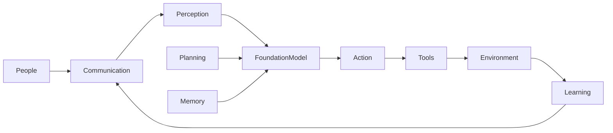
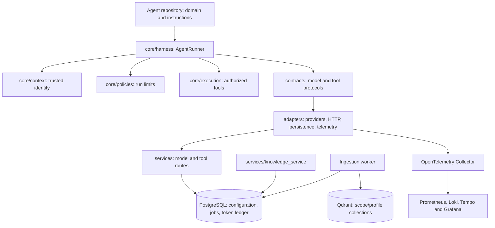

# Current architecture

The reading path is the [enterprise guide](guide.md). The reference agent is [insight](../examples/insight_agent/README.md). The versioned SDK is the reuse boundary. Framework-neutral contracts and policies support agents that own their instructions, tools, and composition.

## Agent components

An agent on this platform has seven components. The reason loop that calls them is [core/harness](../src/core/harness/README.md). The reference agent implements each one.

| Component | Reference | Role in this repository |
|---|---|---|
| Foundation model | [brain.py](../examples/insight_agent/brain.py) | Chooses the next reply. The reference model is scripted. A provider model replaces this file. |
| Perception | [perception.py](../examples/insight_agent/perception.py) | Turns one request into a question. |
| Planning | [planning.py](../examples/insight_agent/planning.py) | Orders the evidence steps. |
| Memory | [memory.py](../examples/insight_agent/memory.py) | Holds the instruction and the required evidence for this run. |
| Action | [action.py](../examples/insight_agent/action.py) and [tools.py](../examples/insight_agent/tools.py) | Runs the loop and calls SQL, Qdrant, Neo4j, the model, and the allowlisted site. |
| Learning | [learning.py](../examples/insight_agent/learning.py) | Records status, tool names, and duration. Weights stay unchanged. |
| Communication | [communication.py](../examples/insight_agent/communication.py) and [host](../examples/insight_agent/host/README.md) | Speaks the result on the question page and the operator API. |

## Platform

## Source ownership

- `src/contracts/` defines ports and typed records without provider clients.
- `src/core/` implements trusted identity, authorized invocation, the loop, and limits.
- `src/adapters/` implements external systems and explicit factories.
- `src/services/` owns API boundaries, credential binding, and background ingestion.
- `src/sdk/python/` owns validated configuration, project commands, and service clients.
- `src/agentic_sdk/` preserves public import compatibility through re-exports. Setuptools maps these folders into one installed namespace.

See [physical source layout](source-layout.md) and [the folder audit index](folder-index.md) for exact files.

## Execution and trust

The host resolves a credential to a fixed tenant/agent context. AgentRunner checks context size, deadline and conservative token reservation before asking DecisionModel for a tool/final action. ToolRegistry validates the JSON schema, permission, prerequisites and trusted mutation approval before invoking the handler. Final answers may require evidence tools. Per-request state is isolated; durable conversation memory is not implemented.

Consumers can use direct SDK adapters or HostedDecisionModel and an approved tool gateway. AgentN business grants and SQL validation remain the existing backend's responsibility. Model output never supplies credentials or permissions. Static local credentials are not end-user federation, and context guards do not sandbox malicious in-process code.

## Local services and data

The platform API process hosts separate registry/model/tool/knowledge route modules. PostgreSQL stores immutable configuration revisions, ingestion jobs and atomic token reservations. A separate worker processes bounded text chunks into agent/profile-specific Qdrant collections. Identical content/profile submissions reuse a job. Content versions are append-only; deletion and document-level ACL lifecycle remain gaps. Publishing configuration does not hot-reload agents.

AgentN run metadata uses a scoped SQLite store. OTLP export sends content-free events to the operator monitoring stack. Event spans are not a fully propagated distributed trace, and shared dashboard labels are not tenant query authorization.

## Ready locally versus release gates

The full local profile is exercised with synthetic model, backend and embedding data. Compatible and native provider adapters exist, but paid/live integrations require separate validation. OIDC delegation, HA, production Helm, knowledge deletion, release artifact certification and operational drills remain [release gates](release-gates.md). Start with the [developer guide](developer-guide.md) and [local runbook](../deployment/full/README.md).
