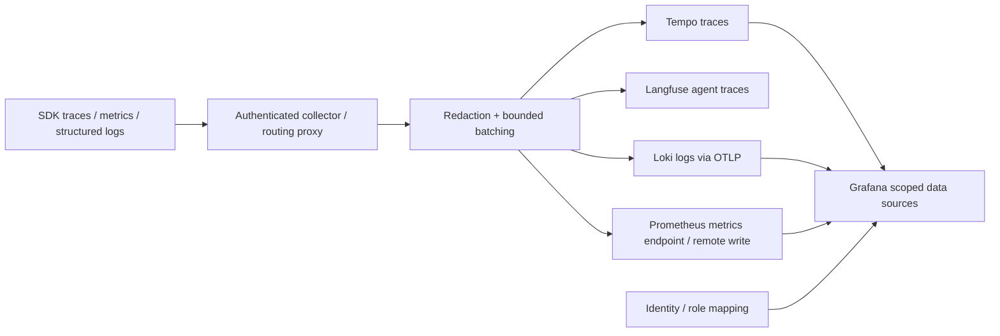

# Observability and per-agent isolation

> Phase-one design reference. For current executable behavior and the separate consuming agent, read [the current implementation map](implementation-map.md). Features described as planned here are not automatically implemented by the new agent API.

Implemented: SafeTelemetry retains content-free events in memory. OTelTelemetry emits a short event span, a request counter and latency histogram; spans do not yet cover the full request or child provider operations. Applications must initialize OTel SDK providers/exporters and flush/shut them down. The supplied collector has no durable backends and no log pipeline. Do not interpret its existence as a complete observability stack.

## Target topology

A deployment may add Langfuse beside Tempo. The collector forwards the same content-free trace: one parent span per run, with a child span per tool. Langfuse is the screen for that agent trace. It does not receive the question, retrieved passages, or the answer.

Use service.name, deployment.environment, tenant_id, agent_id, SDK version, config revision and model route. Do not use request IDs, prompts, document IDs or user IDs as metric labels. Correlate trace/span IDs in structured logs. Trace sampling starts at 10% for success and should retain errors using a tested tail-sampling policy; even unsampled requests need aggregate counters. This sampling is a proposal, not implemented configuration.

## Isolation is server-side

Grafana variables and folder permissions do not prevent data-source queries for other agents. Prometheus OSS does not supply per-agent query authorization by itself. For strong isolation use separate backends/data sources per scope or an authenticated query proxy enforcing labels; authorize all query APIs, including Explore. Loki/Tempo tenant headers must be injected by a trusted proxy from verified identity; caller headers cannot choose the tenant. Verify the chosen deployment's multi-tenancy behavior. Agents cannot write telemetry for another scope: authenticate ingest and overwrite identity attributes at ingress.

For the prototype, trusted administrators may share a backend. Do not grant untrusted agent teams access until query-side isolation is tested. Tests must attempt cross-agent ingestion spoofing, direct API queries, Explore, alert queries and data-source access outside allowed folders.

## Dashboard specification

`deploy/grafana/agent-overview.json` is an importable starter for Prometheus with a selected datasource; backends and credentials must be configured separately. Proposed panels: request rate/error fraction by agent; p50/p95 latency; model input/output tokens; reserved/settled currency; retrieval empty-hit rate; ingestion queue depth/failures/age; provider 429s; disk and backup age. The first three use the implemented OTel metrics, subject to exporter name translation. Other panels require planned instrumentation.

Alerts (starting thresholds): error fraction >5% for 5 minutes with minimum request volume; p95 >10s for 10 minutes; quota at 80% warning/100% deny; ingestion oldest job >15 minutes; collector dropped events >0; disk >70%; backup age >26 hours. Attach owner and runbook, never raw prompt data. Set success sampling/retention only after measuring ingestion rates. Prototype targets: logs 3 days, traces 24 hours, metrics 7 days; production retention depends on compliance and capacity. Exporter queues must be bounded; telemetry failures must not cause indefinite application retries.
