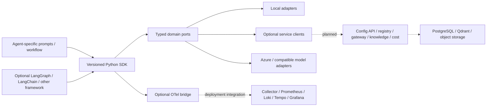

# Historical v0.1 baseline

This file records the first starter; use the root README and reusable-architecture.md for current behavior.

# Agentic Architecture & Best Practices

A framework-agnostic Python foundation for building agents without copying platform plumbing. MIT-licensed reference implementation, version **0.1.0**. This is a runnable prototype and an implementation roadmap, not a production platform. No organization-specific endpoints, credentials, documents, or identifiers are included.

## Start in five minutes

Python 3.11+; no model keys, Docker, Azure account, or paid services required.

```sh
python -m venv .venv
# Linux/macOS
source .venv/bin/activate
# Windows PowerShell instead: .venv\Scripts\Activate.ps1
python -m pip install -e .
python examples/minimal.py
python -m unittest discover -s tests -v
python evaluation/run.py
```

Run from this repository root. Expect a `DEMO:` answer, source `sdk-guide`, and metadata-only telemetry. Hash embeddings and echo responses demonstrate architecture, not language understanding. The example ingests one chunk, retrieves evidence and calls a model port. It does not run an autonomous tool loop. No data survives process exit.

For a container-only demonstration: `docker compose run --build --rm demo`. The container has no network access. Optional data services do not automatically replace the example's memory adapters.

## Design



Solid arrows indicate code-level boundaries, not a fully wired deployment. Dotted arrows are planned/integration work. Agent repositories own business behavior; this SDK owns reusable contracts, guards and adapter implementations. Hosted services are optional deployment choices, not prerequisites for importing the SDK. Frameworks must remain outside domain contracts.

## What works today

| Area | Status in this repository |
|---|---|
| Versioned installable SDK, typed ports, explicit registry | Implemented; standard-library core |
| Local RAG, profile checks, bounded input/output settings | Implemented and offline tested |
| Tenant/agent-scoped memory search; permissions | Implemented cooperative guards; not identity verification |
| Local budget reservation and content-free telemetry | Implemented; no durable billing or distributed quotas |
| Azure v1 / compatible chat and embedding adapters | Implemented optional code; no live cloud validation |
| Qdrant adapter with scoped collections | Implemented optional code; no live server validation |
| OpenTelemetry traces/metrics bridge | Implemented optional code; caller configures exporter; no log exporter |
| Compose demo, PostgreSQL/Qdrant/Collector profiles | Supplied reference configuration; runtime validation depends on Docker |
| PostgreSQL configuration table and RLS starter | SQL supplied; no database adapter or service |
| Portal/config API, hosted registry, model gateway, knowledge workers, distributed cost | Contracts/design only; not runnable services |
| MCP / REST / n8n tool execution | Port and integration contracts only; adapters planned |
| Grafana / Prometheus / Loki / Tempo | Topology, dashboard specification and Grafana JSON starter; backends not deployed |
| Evaluation | Offline retrieval smoke test; live quality/safety/performance gates planned |
| Helm / Kubernetes | Migration plan and resource values draft; no deployable Helm chart |

See [verification](verification.md) for actual checks and limitations. Optional dependencies have compatibility ranges; they are not a reproducible lockfile or a claim that every combination was tested.

## Repository guide

* `src/agentic_sdk/`: domain ports, runtime, configuration, registry, local/network adapters.
* `examples/`, `tests/`, `evaluation/`: runnable example and validation.
* `schemas/`, `config/`: implemented local configuration contract.
* `docs/architecture.md`: ownership, lifecycle, model/index compatibility, framework choices.
* `docs/contracts.md`: hosted API and tool contracts, errors, idempotency.
* `docs/deployment.md`: Ubuntu sizing, hybrid Azure topology, Compose and Helm migration.
* `docs/security.md`, `docs/observability.md`, `docs/nfr-cost.md`: isolation and operational requirements.
* `docs/adr/`: decisions, alternatives and consequences.
* `templates/`: consumer-agent and adapter contribution starters.
* `developer-standards/gcpl-agent-developer/SKILL.md`: reusable developer skill.

## Switching providers

Install `python -m pip install -e '.[providers]'`, then wire adapters at the application composition root:

```python
from agentic_sdk.adapters.providers import client, CompatibleLLM, CompatibleEmbedder
from agentic_sdk.contracts import EmbeddingProfile

# Set MODEL_API_KEY outside source control. Deployment/model names are examples.
c = client("https://YOUR-RESOURCE.openai.azure.com/openai/v1/", "MODEL_API_KEY")
llm = CompatibleLLM(c, "YOUR-CHAT-DEPLOYMENT")
profile = EmbeddingProfile("text-embedding-3-small", "PINNED-MODEL-REVISION", 1536)
embedder = CompatibleEmbedder(c, "YOUR-EMBEDDING-DEPLOYMENT", profile)
```

For another compatible service, replace the base URL and deployment names. Model-specific parameter support must be integration tested: the chat adapter uses `max_completion_tokens`, and embeddings request provider-default dimensions then validate the result. Non-compatible APIs need a separate adapter implementing the same ports. Managed identity, streaming, tool calling, vision and provider-specific reasoning parameters are planned. Do not claim universal endpoint compatibility.

Register approved factories in code; runtime config cannot import arbitrary modules. Register Azure and another vendor under distinct names if their policies differ. The small local config schema deliberately supports only the runnable demo; production provider configuration is specified separately in [contracts](contracts.md).

## Contributing and releasing

Start with [CONTRIBUTING](../CONTRIBUTING.md) and the developer skill. Pin SDK consumers to a tested release (`agentic-foundation-sdk==0.1.0` once published); the name/version here are metadata, not a claim of a PyPI release. Distribute internal wheels until publication. Use SemVer: breaking contracts require major versions after 1.0; during 0.x, minor versions may break compatibility with migration notes. Never copy `src/agentic_sdk` into an agent repository.

Build with `pip install '.[dev]'` then `python -m build`. CI tests core behavior, configuration schema, packaging and Compose syntax; live provider tests and security scans remain release gates to add. Resolve dependencies to reviewed lockfiles and container digests before deployment. The supplied image tags are reference pins, not certified current security baselines.

External references and licensing caveats: [sources](sources.md). The repository license does not relicense bundled-service images or model services. n8n is optional and has fair-code/source-available licensing, not the same open-source license as this SDK.
