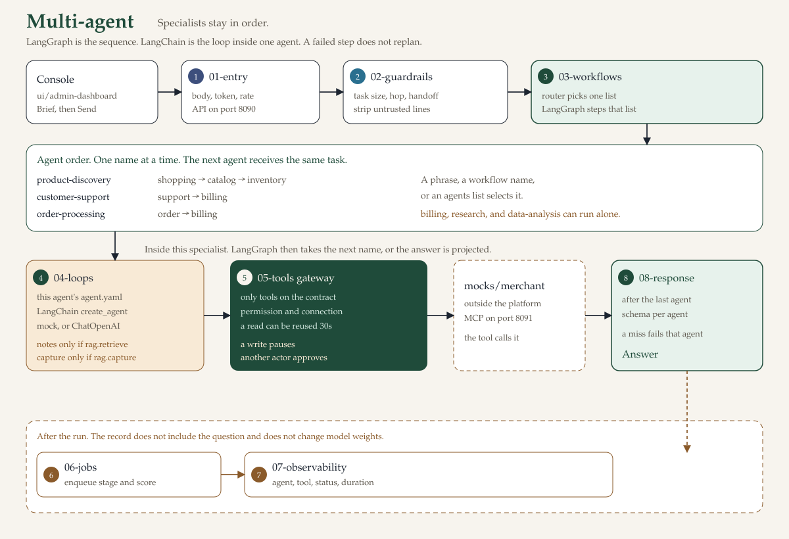

# Multi-agent architecture

This folder is the workflow system. Run the commands below from `multi-agent/`. The single-agent harness is the other top-level folder.

Reference implementation for an industry team building the agentic platform it has announced. The retail agents are the worked example. The contract, the gateway, and the approval rule are the standard you keep.

LangChain runs each specialist from `agent.yaml`. LangGraph sequences the three workflows and pauses for approval. With no API key, a mock model drives the same loop.



Read [docs/using.md](docs/using.md) to run the console and the API. Read [docs/implementation-guide.md](docs/implementation-guide.md) before changing code. Both pages are under Docs in the console. The interactive API page is `/docs`. The written route list is [docs/api.md](docs/api.md).

## Start the reference

`python` is not required on your shell path. This repository keeps its interpreter in `.venv`.

On a laptop:

```bash
./start-local.sh
```

The script starts the API at <http://127.0.0.1:8090> and the console at <http://127.0.0.1:5173>. The local token is `local-dev-token-not-for-production`. Health is `/health`. The platform map is `/platform`. Interactive API docs are `/docs`.

On one server:

```bash
docker compose up -d --build
./infrastructure/smoke.sh
```

That builds `agentic-api` and `agentic-console`. Operators open <http://127.0.0.1:5173>. `CONSOLE_PORT` changes that port. The API stays on the server network. `/health`, `/platform`, and `/docs` are on the console port. Copy names from `.env.example` when you replace the sample token. `PLATFORM_ENV=production` refuses that token until `PLATFORM_DEV_TOKEN` is private.

Prove the path with this task:

```text
Find a blue trail jacket under $150
```

The run is the `product-discovery` workflow: shopping, then catalog, then inventory. Read the live trace. Then open `agentic/04-loops/specialists/catalog-agent/agent.yaml`. That file is the contract: instructions, plugins, memory, permissions, and `output_schema`.

## Seven components

These stay in place when you replace the retail fixtures with your systems.

1. **Perception** — `agentic/01-entry` turns the HTTP body into an `AgentRequest`.
2. **Planning** — `agentic/03-workflows` chooses the agent order. `agentic/02-guardrails/policy` checks hops and delegation. Neither one writes the answer.
3. **Foundation model** — `agentic/04-loops/llm` chooses the next step. Mock mode needs no key. Live mode uses `MODEL_API_KEY`.
4. **Memory** — `agentic/04-loops/memory` holds conversation state, optional notes, and RAG. An agent reads the index only when its contract sets `rag.retrieve`. Capture stores a redacted note only when `rag.capture` is true. Vector and embedding choices include a local index, Qdrant, and AWS.
5. **Action** — `agentic/05-tools/mcp/tool-gateway` calls only the plugins named in `agent.yaml`.
6. **Learning** — the request enqueues a stage or a score. The worker in `agentic/06-jobs/workers` stores it. The record does not include the raw question and does not change model weights.
7. **Communication** — the `AgentResponse` is what the API returns and what the console shows.

Security sits beside those steps: the bearer check in `agentic/02-guardrails/auth/auth.py`, handoff checks in `agentic/02-guardrails/policy/delegation.py` (the allowed pairs come from each `agent.yaml`), redaction in `agentic/02-guardrails/policy/redact.py`, and the approval wait in `agentic/05-tools/mcp/tool-gateway/gateway.py`. Observability is `agentic/07-observability`. The trace records the agent, the tool name, the status, and the duration. It omits the raw question.

`GET /platform` returns this map: the seven steps, security, observability, the live workflow sequences, the n8n tool, and the files a business team edits. The same step names are labels on the `agentic-api` image. The page is [docs/server.md](docs/server.md).

## Standard you do not relax

1. The contract is written before the reasoning loop. LangChain does not own `agent.yaml`.
2. One runtime serves every agent. Authentication, logging, errors, and state are not copied per agent.
3. The gateway is the only caller. A plugin runs only when the contract lists it and the permission is true.
4. Every write stays in `approval.required_for`. The console cannot clear that. The order threshold is `amount_gte` on the order contract, default 100.
5. The console cannot grant `order_write` to a read-only agent, add a tool URL, or show a secret.
6. A result that misses `output_schema` is rejected.
7. Optional long-term memory may be read. It must not be invented. Citations must be known sources.
8. Instruction-like text in a task or a document is stripped.
9. An operator cannot approve a request raised by their own agent.
10. `PLATFORM_ENV=production` refuses the sample token.
11. Tests cover route, plugin, schema, denial, injection, and approval. Ruff is the Python check. Line length is 100.

The full placement rules are in [docs/implementation-guide.md](docs/implementation-guide.md).

## Folder structure

The console is `ui`. The request path is `agentic`, numbered in the order a request moves. `agentic/platform` is configuration and composition. It is not a request step. Python imports the numbered folders as `entry`, `guardrails`, `workflows`, `loops`, `tools`, `jobs`, `observability`, and `response` through `agentic/bootstrap.py`.

```text
agentic-architecture/
├── ui/
│   ├── admin-dashboard/
│   │   └── src/
│   │       ├── views
│   │       ├── agent
│   │       ├── plugins
│   │       └── config
│   └── packages/
│       └── controls/
│           └── src
├── agentic/
│   ├── platform
│   ├── 01-entry/
│   │   └── routes
│   ├── 02-guardrails/
│   │   ├── auth
│   │   ├── limits
│   │   ├── policy
│   │   └── connections
│   ├── 03-workflows/
│   │   ├── router
│   │   ├── sequences
│   │   ├── engine
│   │   └── state
│   ├── 04-loops/
│   │   ├── runtime
│   │   ├── llm
│   │   ├── memory
│   │   └── specialists
│   ├── 05-tools/
│   │   └── mcp/
│   │       ├── tool-gateway
│   │       ├── catalog-tools
│   │       ├── order-tools
│   │       ├── billing-tools
│   │       └── support-tools
│   ├── 06-jobs/
│   │   ├── queue
│   │   └── workers
│   ├── 07-observability/
│   │   ├── trace
│   │   ├── evaluation
│   │   └── sinks
│   └── 08-response/
│       ├── contracts
│       └── project
├── mocks/
│   └── merchant
├── infrastructure
├── docs
└── tests
```

`ui/admin-dashboard` is the operations console. A gear on each agent opens that agent's configuration. Those fields come from `@agentic/controls` in `ui/packages/controls`. See [Console controls](docs/ui-controls.md).

`agentic/01-entry` receives the task. `agentic/03-workflows/router` chooses the agents. `agentic/02-guardrails/policy` stops a plan that is too long or that hands work to an agent that is not allowed. `agentic/03-workflows/engine` runs that plan. `agentic/03-workflows/state` keeps the run so a different actor can approve or reject it.

Each specialist is a folder such as `agentic/04-loops/specialists/catalog-agent/` with one `agent.yaml`. `agentic/04-loops/runtime/runtime.py` runs the same LangChain loop for every agent.

`agentic/05-tools/mcp/tool-gateway` is the only code that calls a plugin. Catalog, orders, billing, and support are the clients. The mock merchant, an outside store, is `mocks/merchant`.

`agentic/06-jobs/queue` accepts runs onto two workers. `agentic/06-jobs/workers` is the only writer of traces, scores, and feedback. `deploy` and `docker-compose.yml` run the API and the console as two images. `tests` checks routes, plugins, schema, denied calls, injection text, and approval.

## How one request moves

LangChain is the loop inside one agent. LangGraph is the sequence of agents in `agentic/03-workflows/engine` only. A workflow file is only an `AGENTS` list. n8n is the simulated `invoke_n8n` tool. It is not the sequencer and this repository does not host it.


The picture is `docs/assets/architecture.svg`. When the request path or the console flow changes, update that file in the same change.

1. The console sends the brief and shows "Working in the background. This page will update when the run finishes."
2. `agentic/01-entry` checks the body size, the rate limit, and the bearer token.
3. `agentic/02-guardrails` checks the task size and strips instruction-like lines.
4. The picker in `agentic/03-workflows/router` uses an agents list, then a workflow name, then a phrase. The workflow file is only the `AGENTS` list.
5. An unknown agent, a hop past the limit, or a refused handoff ends the run before a tool is called.
6. The run is stored. LangGraph steps one agent at a time. Cancel is checked before each step. A timeout or a failure ends the graph.
7. The loop loads the contract, optional notes, retrieval only when `rag.retrieve` is set, and capture only when `rag.capture` is set.
8. LangChain `create_agent` chooses the tool. Mock mode needs no key. Live mode is `ChatOpenAI` with `MODEL_API_KEY`. LangGraph is not inside this loop.
9. The gateway checks the allowlist, the permission, the connection, and a repeated-call stop. A successful read can be reused for 30 seconds. A write is not cached.
10. A write in `approval.required_for` pauses. A different actor approves and the remaining agents run, or a rejection ends the run.
11. The result is projected onto `output_schema`. A missing field fails that agent.
12. The job queue can run two requests together. Agents inside one run stay in order. The timeout wrapper is one thread. It is not a second worker.
13. The observability worker stores the stage, the score, and the export marker. The question is omitted. Later feedback uses the same queue.
14. The done event replaces the whisper with the sentence and the product table.

A failed step does not replan. The next agent receives the same task. Learning does not change model weights.

| Workflow | Agents, in order | Selected when the task contains |
| --- | --- | --- |
| `product-discovery` | shopping, catalog, inventory | jacket, boot, lamp, stock, shop, product |
| `customer-support` | support, billing | refund, return, order status, order 1001, order 1002 |
| `order-processing` | order, billing | place an order, prepare an order, checkout, `buy ` |

`billing`, `research`, and `data-analysis` can run as one specialist. Billing is also a step in support and in order processing. Add a sequence by creating `agentic/03-workflows/sequences/<name>/workflow.yaml`. The router loads that file. The console Workflows tab reads the live list from `GET /platform`. The full path is [docs/workflows.md](docs/workflows.md). Onboarding a new agent is [docs/onboard-agent.md](docs/onboard-agent.md).

n8n is the write tool `invoke_n8n`, permission `n8n_write`. The workflow file stays the order of agents. The tool waits for approval. `N8N_BASE_URL` records an n8n you already run. The call stays simulated until the body of `invoke_n8n` posts to that URL. No reference agent lists `n8n_write` today.

## Add your agent

State the problem. The command writes the contract, the tool, and the workflow. Replace the tool function with the system that solves it, then restart the API. The live Azure check is in [docs/onboard-agent.md](docs/onboard-agent.md).

```bash
./new-agent.sh claims "Look up whether a claim is open and explain the next step"
```

The gear opens Configuration for that agent. The tabs are instructions, memory, observability, retrieval, tools, and workflows. Connectors store a URL, connection string, username, and password, and a saved password is not shown again. A permission the contract sets to false stays off. A write stays behind approval.

| Change | File |
| --- | --- |
| Instructions, tools, permissions, output schema, route phrases, handoffs | `agentic/04-loops/specialists/<name>/agent.yaml` |
| A plugin and the function that answers it | `agentic/05-tools/mcp/<domain>-tools/tools.py` |
| SQL, web, or n8n stand-in | `agentic/05-tools/mcp/tool-gateway/ports.py` |
| Agent order and the words that select a workflow | `agentic/03-workflows/sequences/<name>/workflow.yaml` |
| A case the evaluation run must pass | `tests/agent-evaluation/cases.json` |

## Observability

The request only enqueues a small record: run id, stage or score, agent, tool, status, and duration. The worker in `agentic/06-jobs/workers` is the only writer of the in-memory trace, the evaluation record, the feedback, and `traces.log`. The question is not a field. The run response waits until that worker has stored the trace. OpenTelemetry and a log store are optional addresses on the contract, configured with `OTEL_EXPORTER_OTLP_ENDPOINT` and `OBSERVABILITY_LOG_URL`. Field names and the feedback call are in [docs/operations.md](docs/operations.md).

## Tools you attach over years

The contract keeps the plugin name. The environment points at the host. Leave a port on its local stand-in until that host exists.

| Port | Variables | What this reference does |
| --- | --- | --- |
| Model | `PLATFORM_LLM_MODE=live`, `MODEL_API_KEY`, `MODEL_BASE_URL`, `MODEL_NAME` | Calls an OpenAI-compatible chat endpoint, including Azure OpenAI at `/openai/v1` |
| SQL | `SQL_CONNECTION` | Marks the port configured. `query_sql` still returns the local `SELECT` fixture |
| Web | `WEB_ALLOWLIST` | Denies a host that is not listed. The page body stays local |
| n8n | `N8N_BASE_URL`, `N8N_TOKEN` | Does not call n8n. The write stays simulated and still needs approval |
| Vector search | `QDRANT_URL` | Marks Qdrant configured. Empty uses the local document index |
| Graph | `NEO4J_URL` | Marks Neo4j configured. It does not open a Neo4j session. Memory retrieval still uses the local entity graph |

The console shows whether each variable is set. It does not show the value. SQL, web, and n8n stay unavailable until a contract already has `sql_read`, `web_read`, or `n8n_write`.

## Where it runs

`./start-local.sh` starts both processes on the laptop. The API is `127.0.0.1:8090`. The console is `127.0.0.1:5173` and is the only page a browser opens.

`docker compose up -d --build` is the organization server. It builds `agentic-api` and `agentic-console` on that one machine. Operators open port 5173, or `CONSOLE_PORT` when that port is taken. The API image is private to the server network. `GET /platform` on the console port names the seven steps, security, observability, the workflow sequences, the n8n tool, and the files a business team edits. Prove it with `./infrastructure/smoke.sh`. The images, an Azure layout, and where Grafana and Kibana sit are in [infrastructure/README.md](infrastructure/README.md). The placement rules are in [docs/server.md](docs/server.md).

A server with about 16 GB of RAM can start Grafana, Prometheus, Langfuse, MLflow, n8n, and the other connector hosts from [infrastructure/dependencies/docker-compose.yml](infrastructure/dependencies/docker-compose.yml). Lab logins are in that folder's README. The API still keeps its trace in process.

An industry host keeps those two processes. One API process stays on a private address, because approvals, traces, and notes live in that process. Two workers run a queue of 32. A full queue is `503`. Each caller is limited to 120 requests a minute (`429`) and a body of 256 KB (`413`). A repeated successful read is reused for 30 seconds inside the process. A write and the brief are not cached. HTTP responses stay `no-store`. Many callers from many addresses need a limiter in front of this private API. Operators open the console, and the console proxies to that API. The model, SQL, n8n, Qdrant, and Neo4j are other hosts you already run. Set one variable when that host is ready. Secrets stay in the API environment. `PLATFORM_ENV=production` refuses the sample token. The placement rules are in [docs/operations.md](docs/operations.md).

## Tests

```bash
.venv/bin/python -m unittest tests.unit.test_runtime tests.integration.test_api tests.security.test_security
.venv/bin/python tests/agent-evaluation/run.py
.venv/bin/python -m ruff check agentic tests
npm test --prefix ui/admin-dashboard
docker compose up -d --build && ./infrastructure/smoke.sh
```

The console test checks the shared controls, including the gear and the dropdown. The smoke script checks the published port: eight agents, all seven steps, security, observability, the business edit paths, and a catalog run that calls `search_products`.

## Guide

| Page | Use it when you need |
| --- | --- |
| [Using this repository](docs/using.md) | How to start, use the console, call the API, and see where a change goes |
| [API](docs/api.md) | Every route, its body, who calls it, and how to add one |
| [Implementation guide](docs/implementation-guide.md) | The standard, where a change goes, and the build sequence |
| [One server](docs/server.md) | The two images, the seven steps, and the files a business team edits |
| [Operations](docs/operations.md) | The trace, n8n and the other ports, and where the two processes run |
| [Repository](docs/repository.md) | The folder map in more detail |
| [Architecture](docs/architecture.md) | The seven components and the folders that own them |
| [Workflows](docs/workflows.md) | When a sequence is required, how to add one, and where n8n fits |
| [Onboard an agent](docs/onboard-agent.md) | Add an agent, a tool, or a workflow, and prove it with Azure OpenAI |
| [Agent catalog](docs/agent-catalog.md) | The reference specialists and how to copy one |
| [Tool contracts](docs/tool-contracts.md) | Each plugin, its permission, and whether it needs approval |
| [Console controls](docs/ui-controls.md) | The shared fields and the gear that opens an agent's configuration |
